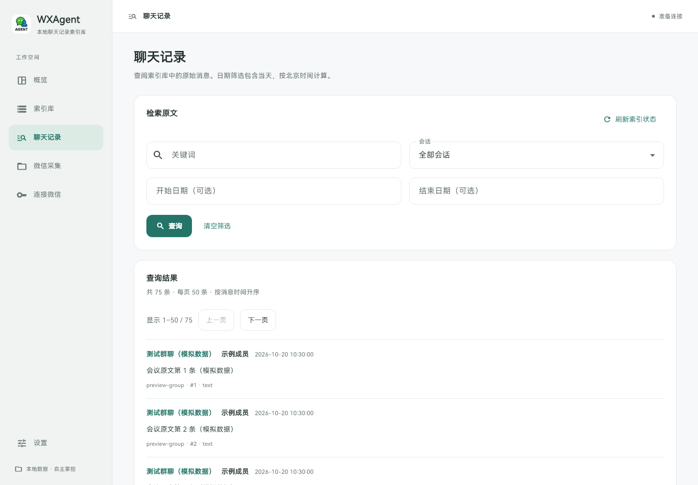

# WXAgent

**本地聊天记录索引库 · CLI 优先 · GUI 可选**

将聊天导出文件增量存入 SQLite，按会话、日期和关键词检索原文。CLI、桌面界面和本地 HTTP 接口共用一份数据库。记录保存在本机，不集成 AI 分析、AI 总结或模型服务。

[下载 v1.1.0](https://github.com/angelo-xuang/WXAgent/releases/tag/v1.1.0) · [快速开始](QUICKSTART.md) · [CLI 文档](docs/CLI.md) · [Skill](skills/wxagent-index/SKILL.md) · [更新记录](CHANGELOG.md)

## 下载与安装

Windows 10/11 x64 下载 [WXAgent-v1.1.0-windows-x64.zip](https://github.com/angelo-xuang/WXAgent/releases/download/v1.1.0/WXAgent-v1.1.0-windows-x64.zip)，完整解压后双击 `Install.cmd`，或在解压目录打开 PowerShell：

```powershell
powershell -NoProfile -ExecutionPolicy Bypass -File .\install_windows.ps1
```

安装不需要管理员权限，也不需要安装 Go、Flutter 或数据库服务。安装后可从开始菜单或桌面的 **WXAgent** 打开界面。重新打开终端即可使用：

```powershell
wxagent version
wxagent --export-dir "D:\聊天导出" import
wxagent sessions
wxagent messages --keyword "项目" --limit 50
```

| 位置 | 用途 |
| --- | --- |
| `%LOCALAPPDATA%\Programs\WXAgent\versions\1.1.0` | 当前版本程序 |
| `%LOCALAPPDATA%\Programs\WXAgent\bin` | 注册到用户 PATH 的 CLI 入口 |
| `%LOCALAPPDATA%\WXAgent\config.json` | 本机配置 |
| `%LOCALAPPDATA%\WXAgent\data\wxagent.db` | 默认聊天索引数据库 |

升级保留已有配置与数据。旧便携目录的记录不会被自动搬移；可用 `import` 显式导入原 JSON，或在设置中选择已有索引。卸载入口位于 Windows“已安装的应用”，卸载保留数据目录。

也可不安装，直接在解压目录双击 `WXAgent.exe`，或执行 `.\backend\wxagent.exe --config .\config.json help`。便携模式的默认数据存放在解压目录，和安装模式分开。

## 索引与归档

```text
聊天导出 JSON → 增量导入 → 本地 SQLite → CLI / GUI / HTTP
       ↑
Windows 微信采集（可选）
```

- **增量导入**：用源文件指纹跳过未变文件，重复导入不会重复记账。
- **保留历史**：源文件缩短或移走，不自动删除已入库记录。
- **原文检索**：按稳定会话 ID、日期和正文关键词筛选，保留发送者及时间。
- **完整分页**：CLI 默认返回全量，可显式指定 offset/limit；GUI 显示分页及匹配总数。
- **失败回滚**：一批导入中的文件损坏时整批回滚，源 JSON 始终只读。
- **脚本集成**：JSON 结果写入标准输出，错误和日志单独输出；可以交给其他工具处理。

索引按文字匹配查询，不做语义推断。没有稳定消息 ID 的导出格式存在跨快照去重边界，详见 [数据约定](docs/CLI.md)。

## 桌面界面

GUI 提供索引导入、原文检索、分页浏览及本机路径设置。微信采集作为辅助入口，不影响使用已有 JSON。



## 本地接口与 Skill

```powershell
wxagent serve --host 127.0.0.1 --port 8000
```

主要接口：`GET /sessions`、`GET /messages`、`GET /stats`、`GET /index/status` 和 `POST /index/import`。默认只监听本机，接口没有公网认证。

[wxagent-index Skill](skills/wxagent-index/SKILL.md) 说明如何调用 CLI、读取完整分页和引用原文，可按所用助手的方式添加到技能目录。它不引入模型依赖，也不会自动触发微信采集。

## 平台范围

| 平台 | 索引与 CLI | GUI | 原始微信采集 |
| --- | --- | --- | --- |
| Windows x64 | 已有发布包 | 已有发布包 | 保留已有组件，需要匹配的本机微信环境 |
| macOS | 可从源码构建，跨平台测试通过 | CI 检查构建，尚无安装包 | 待适配 |
| Linux | 可从源码构建，跨平台测试通过 | 未提供发布包 | 待适配 |

Mac 可先导入其他平台生成的 JSON。Mac 微信接入、应用签名和分发仍需单独验收，详见 [macOS 说明](docs/MACOS.md)。

## 源码开发

仅编译 CLI 需要 Go 1.24 或兼容版本：

```powershell
cd backend
go build -o wxagent.exe ./cmd/wxagent
./wxagent.exe --config config.local.json init
./wxagent.exe --config config.local.json --export-dir "D:\聊天导出" import
```

macOS / Linux 将输出名改为 `wxagent`。GUI 使用 Flutter 3.35.7 / Dart 3.9.2。格式与测试：Windows 运行 `./scripts/dev.ps1 check`，其他平台运行 `bash scripts/dev.sh check`，仅检查 CLI 可追加 `go`。

| 目录 | 用途 |
| --- | --- |
| `backend/cmd/wxagent/` | CLI 入口 |
| `backend/internal/dataset/` | JSON 解析、SQLite 索引与查询 |
| `backend/internal/server/` | 本地 HTTP 接口 |
| `frontend/` | Flutter GUI |
| `launcher/` | 桌面进程启动及管理 |
| `scripts/` | 构建、安装和质量检查 |
| `skills/wxagent-index/` | 外部助手调用约定 |

更多信息见 [开发说明](docs/DEVELOPMENT.md) 与 [发布指南](docs/RELEASE_GUIDE.md)。`v1.0.0` 历史包继续保留；新版本已移除旧 AI 命令、接口和模型设置。

聊天数据、数据库、密钥与个人配置不提交到 Git。使用本人有权访问的记录；向外部助手提供数据时，由使用者决定处理范围。
